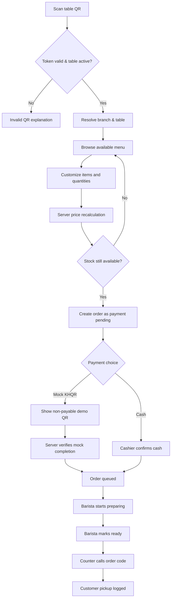

# SYSTEM.md — Kafé Tonlé QR Ordering, Barista Queue and Loyalty

> **Mission:** A functional 3-branch demo connecting a public menu, anonymous table QR session, mock payment, real-time preparation workflow, order number display and loyalty ledger. Follow `../00-SHARED-FOUNDATION.md` and `WEBSITE.md`.

## 1. Actors, roles and screens

| Role | Screens | Allowed actions |
|---|---|---|
| Guest/customer | `/order/[token]`, cart, checkout, status | Order for QR table, select options, pay in mock, track using opaque order token |
| Registered rewards customer | `/rewards`, order pages | Guest actions + view own loyalty/stamps and redeem reward |
| Barista (branch-scoped) | `/app/barista`, `/app/queue` | See **own branch** paid/cash-confirmed orders, claim/start, mark ready, mark collected |
| Cashier (branch-scoped) | `/app/pos`, `/app/queue` | Confirm cash, cancel/refund by permission, handle pickup |
| Manager (branch-scoped) | `/app/menu`, `/app/orders`, `/app/reports` | Branch availability, staff shifts, voids, branch sales |
| Owner | `/app/dashboard`, `/app/branches`, `/app/staff`, `/app/menu` | All branches, global catalogue, employee roles, reports and audit |

Customer tracking is token-scoped; authentication cannot be bypassed by using a guessed order number.

## 2. Key user journeys — implement in order

### Flow A: Guest table order → mock payment → barista → pickup

**Detailed rules:** token includes random UUID/opaque secret mapping to active table and branch, not a predictable table ID. An order contains immutable unit-price snapshots, branch, table, item options and demo payment method. Only **paid** mock-KHQR or **cash-accepted** orders enter work queue. Barista changes are atomic and branch-scoped. WebSocket sends events `order.created`, `order.paid`, `order.preparing`, `order.ready`, `order.collected` with branch channel filter. Reconnect via GET snapshot and event cursor. Emit max one order per checkout idempotency key.

### Flow B: Table QR setup

Owner/manager creates table, obtains unique random URL, downloads QR SVG/PDF, may rotate/revoke. A disabled/rotated token must show a graceful error. QR encodes **ordering URL only**, never payment credentials.

### Flow C: Loyalty stamp and redemption

After payment verification, count eligible paid drinks (not bakery) → append a stamp ledger entry for each eligible drink (excluding redeemed free unit) → once account has **nine** unconsumed paid stamps, offer a voucher redeemable on the **tenth** eligible drink. At checkout, atomically consume nine stamps and apply up to a configured free-drink price cap (demo $4.00) to one drink. Do not earn a stamp on the free unit. Partial cancellation/refund generates compensating ledger transactions, not silent deletes. Guest orders without linked account do not earn retroactive stamps by default.

### Flow D: Branch menu and sold-out toggle

Owner manages common products and modifiers; manager overrides `available` per branch. The customer-facing listing and server order validation both use the branch override. Hide order button for sold-out products but preserve historical order references.

## 3. Data model (PostgreSQL)

| Table | Core fields / constraints |
|---|---|
| `branches` | id, code UNIQUE, name, timezone, example_location, is_active |
| `cafe_tables` | id, branch_id FK, table_label, qr_token_hash UNIQUE, active, created_at; UNIQUE(branch_id, table_label) |
| `menu_categories` | id, name_i18n, sort_order |
| `menu_items` | id, category_id, slug UNIQUE, name_i18n, description_i18n, base_price_minor, currency='USD', image_key, is_active, eligible_loyalty |
| `item_option_groups` / `item_options` | item_id, group name, choice type, min/max selects; option label, price_delta_minor |
| `branch_item_availability` | UNIQUE(branch_id, item_id), is_available, updated_by |
| `customers` | id, demo_alias, demo_phone_id UNIQUE NULLABLE, telegram_test_id NULLABLE |
| `orders` | id, public_code UNIQUE, tracking_token_hash UNIQUE, branch_id, table_id, customer_id NULLABLE, status, payment_status, subtotal_minor, discount_minor, total_minor, idempotency_key UNIQUE, timestamps |
| `order_items` | id, order_id, item_id, display_name_snapshot, unit_price_minor, qty, total_minor, notes |
| `order_item_options` | order_item_id, group/option names snapshots, amount_minor |
| `payments` | shared payment shape, order_id FK, transition audit |
| `loyalty_ledger` | id, customer_id, order_item_id NULLABLE, reward_id NULLABLE, delta_stamps, reason, created_at; unique earn per order item unit identity |
| `rewards` | id, customer_id, status `available/redeemed/revoked`, discount_cap_minor, redeemed_order_id |
| `order_status_history` | order_id, old_status, new_status, actor_id, timestamp |
| `users` / `user_branch_roles` / `audit_events` / `outbox_notifications` | shared foundation schemas |

Indexes: `orders(branch_id,status,created_at)`, `orders(created_at)`, `loyalty_ledger(customer_id,created_at)`, `branch_item_availability(branch_id,item_id)`.

## 4. State machine and invariants

`DRAFT → AWAITING_PAYMENT → QUEUED → PREPARING → READY → COLLECTED`; payment timeout may go `AWAITING_PAYMENT → EXPIRED`; manager `QUEUED/PREPARING → CANCELLED` with reason; if paid and refund warranted, separate `refund_status` transition. Disallow skipping `QUEUED → READY` without explicit manager override logged. Every transition requires optimistic version or row lock. Cash orders stay awaiting payment until cashier confirmation. Multiple WebSocket clients must not process the same transition twice.

## 5. API contract (representative; implement OpenAPI detail)

**Public:** `GET /v1/branches`, `GET /v1/menu?branch_id=`, `GET /v1/menu/{slug}?branch_id=`, `GET /v1/table-sessions/{token}`, `POST /v1/orders` (token, items, choices, idempotency_key), `GET /v1/orders/track/{tracking_token}`, `POST /v1/orders/{id}/mock-checkout`, `GET /v1/rewards/me` (authenticated).

**Staff:** `GET /v1/staff/orders?branch_id=&status=`, `PATCH /v1/staff/orders/{id}/status` (`expected_version`, `status`, `reason`), `POST /v1/staff/orders/{id}/confirm-cash`, `PATCH /v1/branches/{id}/availability/{item_id}`, `GET/POST/PATCH /v1/admin/menu-items`, `POST /v1/admin/tables`, `POST /v1/admin/tables/{id}/rotate-token`, `GET /v1/reports/sales?from=&to=&branch_id=`, `GET /v1/reports/top-items`.

**Realtime:** `/v1/ws/branch/{branch_id}/orders` JWT with branch authorization; for tracking use token-limited SSE endpoint `/v1/orders/track/{tracking_token}/events`. Never include customer PII or staff secrets in public streams.

## 6. UI implementation details

- **Barista tablet:** two columns `New orders` and `Preparing`, each card shows order code, elapsed time, exact modifiers, paid type, table, `Start` / `Ready`. Newest events update without page refresh; optimistic updates roll back on API conflict.
- **Queue TV:** big order code tiles, grouped `Preparing` and `Ready`; no personal names, payments or internal notes. Auto-resync after disconnection.
- **Cashier:** pending cash orders, amount, `Cash received` (demo) and `Cancel`. Confirmation emits queue event.
- **Owner charts:** sales by branch/day, top 10 menu items, peak order hours (Phnom Penh timezone), order turnaround from queued to ready. Refunds deducted. `Download CSV` for demo summary only.
- **Order tracking:** visible progress steps, order content and receipt; obscure tracking token from analytics; never expose another order.
- **Staff settings:** branch membership, table QR management, simple item management with image upload and modifier-group form.

## 7. Demo seeds and calculated metrics

Branches: Riverside (RIV), Toul Kork (TK), BKK1 (BKK). Tables: 8 each. Products: all 11 from `WEBSITE.md` with 2–3 modifiers where appropriate. Users: owner, 3 managers, 3 baristas, 3 cashiers, 2 rewards customers. Orders: at least 150 across 30 days with realistic status distribution. One customer has six stamps, another nine ready to redeem. Seed one pending cash order, one prepared order, one sold-out signature drink in BKK1, and one invalid QR URL demo.

Sales = sum verified paid total minus confirmed refunds, grouped by transaction day in `Asia/Phnom_Penh`; peak hours = order payment time, not creation time. All charts recalculate from seed records.

## 8. Failure paths and security tests

- Invalid/disabled QR → no table leak; expired checkout → no queue entry; double-click checkout → one order; duplicate mock callback → one payment; sold-out during cart → revalidate and explain; invalid options → 422 with field errors.
- Two baristas tapping `Start` simultaneously → one success, other 409; barista accessing different branch → 403; guest guessing public code → no personal details without tracking token.
- Refund a stamped order → reverse ledger; simultaneous redeem attempts → one reward only; offline WebSocket → REST fallback and recovery.
- JWT expiry, unauthorized role and rate-limited anonymous requests tested.

## 9. Acceptance tests / implementation slices

1. **Foundation:** migrations + seed + auth/branch scopes; Playwright login per role.
2. **Order MVP:** scan demo table, customize drink, place mock payment, get status and receipt, cashier cash path.
3. **Staff realtime:** barista starts/finishes; TV moves codes; customer tracking changes without refresh.
4. **Operations:** branch-specific sold out, menu CRUD, QR rotation, orders filter, daily and branch charts.
5. **Loyalty:** nine stamps -> tenth free; refunds and concurrent claims maintain balances.
6. **Polish:** Khmer localization, errors/offline states, responsive tests, audit log, demo reset, docs/case study.

### Definition of done

A visitor completes QR order on phone; barista updates it on tablet; TV shows Ready; visitor sees matching status; owner sees accurate revenue; rewards customer redeems tenth drink; all with **fake data, no real payment**.
