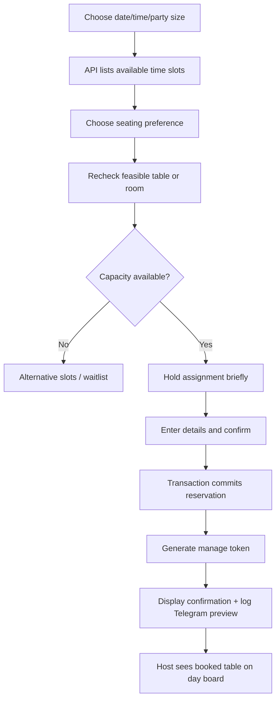
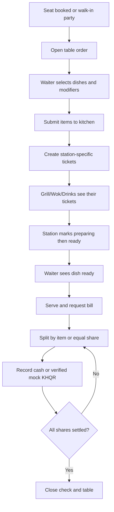

# SYSTEM.md — Phum Kitchen Reservations + POS + Kitchen Display

> Build real domain logic linking online bookings, restaurant floor plan, waiter POS, split bills, kitchen station tickets and reporting. Public copy and images are in `WEBSITE.md`.

## Roles and interfaces

| Actor | Primary route | Access |
|---|---|---|
| Guest | `/reserve`, `/reservation/[token]` | Browse true demo availability, reserve, manage own booking using opaque token |
| Host | `/app/reservations`, `/app/floor` | Manage seating, walk-ins, waitlist, arrival/no-show, assigned tables |
| Waiter | `/app/pos`, `/app/tables` | Start dine-in order for own assigned table, add dishes, send to kitchen, request bill |
| Kitchen staff | `/app/kds/[station]` | Only station tickets (grill/wok/drinks); acknowledge/start/ready |
| Cashier | `/app/checkout` | Split bills, record mock cash/KHQR, print receipt |
| Manager | `/app/management` | Configure schedules, menus, rooms, staff, override with audit |
| Owner | `/app/dashboard` | Full view, menu and staff admin, reporting and settings |

No payment on reservation by default; booking is independent of table-order payments. Private-room request may need manual host approval for large groups.

## Core workflows

### A. Website booking with atomic availability

Date/time shown in Asia/Phnom_Penh, store UTC. Availability respects operating hours, reserved time window + configurable 15-min turnover buffer, floor table capacity, composite table ability only if explicitly configured, private-room requirements and temporary holds. A reservation hold expires after 5 minutes; no double booking is possible via exclusion constraints/transactional locks. Window defaults 90 minutes for 1–4 and 120 minutes for 5–8, configurable per booking. Bookings for 9–16 require group/room handling and may become `REQUESTED` for host approval. Do not promise more than real sample capacity.

Statuses `REQUESTED` (manual large group) or `CONFIRMED → SEATED → COMPLETED`; `CONFIRMED → CANCELLED`, `CONFIRMED → NO_SHOW`; `REQUESTED → REJECTED`; optional `CONFIRMED → MODIFIED` event then remains `CONFIRMED`. Status changes logged, notifications in simulated outbox. Customer reschedule reacquires capacity **atomically** before releasing original slot; prevents loss of reservation if new time is full.

### B. Host day board + drag-and-drop floor plan

Manager adds dining areas (Indoor/Outdoor/Private), table shapes, seats and `(x,y,width,height,rotation)` coordinates to a floor plan version. Host sees current seating status plus timeline view, clicks booking -> `Assign/Seat/Finish/No-show`. Drag movement modifies visual coordinates; **does not** imply reservation reassignment. Table reassignment requires conflict check and explicit save. Real-time occupancy updates to POS/waiter.

### C. Waiter POS → KDS → checkout

Kitchen timer warns at 15 minutes from submission: visually **red** and with icon/text `Over 15 min`; no fabricated kitchen time if server unavailable. Modifications after send produce **delta tickets**, not duplicate entire order. Dish void after kitchen starts requires manager reason. Multiple waiters editing same check use version checks. Bill split allocates each line exactly once, supports item-level splitting and proportional split with cent remainder assigned deterministically so splits sum exactly to original total. Cash and KHQR are demo transactions.

### D. Walk-in and waitlist

Host selects party size and arrival; system finds feasible table or places them on waitlist. On seating a walk-in, create a seated allocation and POS session; website availability must reflect that occupancy. Late customers may be marked no-show after configurable grace period (e.g., 15 min); never auto-cancel immediately.

## Database model

| Table | Essential columns / rules |
|---|---|
| `dining_areas` | id, name, seating_type, capacity_notes |
| `restaurant_tables` | id, area_id, label UNIQUE, capacity, active, geometry_json, floor_version |
| `table_combinations` | id, member_table_ids, combined_capacity, enabled; combinations cannot overlap with other active assignments |
| `reservations` | id, reference UNIQUE, guest_alias, contact_demo, party_size, start_at, end_at, status, assigned_table_group_id, preference, confirmation_token_hash, version |
| `reservation_table_allocations` | reservation_id, table_id, start_at/end_at, active; overlap prevention |
| `reservation_holds` | hold_token_hash, table group, start/end, expires_at |
| `waitlist_entries` | party_size, created_at, status, notified_at |
| `menu_categories`, `dishes` | slug, localized fields, example price_minor, spice, tags, allergy notes, active |
| `orders` | id, table_id, reservation_id NULLABLE, status, started_at, subtotal, total, version |
| `order_items` | snapshot price/name, qty, seat_no NULLABLE, course, kitchen_station, item_status |
| `kitchen_tickets` | order_item_id, station, status, submitted_at, started_at, ready_at |
| `bill_splits` / `bill_split_items` | split amount, proportions/line refs, status, full allocation constraint |
| `payments` | split_id, method, status, verified_at, idempotency_key |
| `staff_roles`, `shifts`, `floor_layout_versions`, `audit_events`, `outbox_notifications` | authorization and trace |

Create indexes on reservations `(start_at,status)`, assignments `(table_id,start_at,end_at)`, KDS `(station,status,submitted_at)`, payments `(verified_at)`. For PostgreSQL use `tstzrange` exclusion with `btree_gist` where practical to prevent overlapping active allocations; handle table combinations under transaction lock.

## APIs and realtime events

**Public:** `GET /v1/booking/slots?date=&party_size=&seating=`, `POST /v1/booking/holds`, `POST /v1/reservations`, `GET /v1/reservations/manage/{token}`, `PATCH /v1/reservations/manage/{token}` (reschedule/cancel), `GET /v1/menu`, `POST /v1/contact/demo`.

**Host:** `GET /v1/host/reservations?date=`, `PATCH /v1/host/reservations/{id}`, `POST /v1/host/walk-ins`, `GET/POST /v1/host/waitlist`, `GET /v1/floor`, `PATCH /v1/floor/layout`, `PATCH /v1/host/reservations/{id}/table`.

**POS/Kitchen:** `POST /v1/pos/orders`, `POST /v1/pos/orders/{id}/items`, `POST /v1/pos/orders/{id}/send`, `PATCH /v1/kds/tickets/{id}`, `POST /v1/pos/orders/{id}/split`, `POST /v1/pos/splits/{id}/checkout`, `GET /v1/pos/orders/{id}/receipt.pdf`.

**Realtime**: `reservation.created/updated/cancelled`, `table.occupied/freed`, `order.submitted`, `ticket.started/ready`, `payment.confirmed`, scoped to staff roles and kitchen station where applicable. SSE/polling fallback.

## Screen specifications

**Reservation board:** date picker, counters `Booked/Expected covers/Seated/No-show`, timeline against table/room, list filter by time/status, booking drawer with edit/confirm/seat actions and audit. **Floor plan:** draggable table shapes with capacity badges and colored + textual state legends; edited positions persist.

**Waiter POS tablet:** left area/table list; menu categories/product cards center; current table ticket/right panel; notes, seat numbers, void-with-reason, send-to-kitchen, request bill. **KDS:** three station views plus optional unified all-stations board; large count-up timer (red after 15 min); `Start`, `Ready` with state verification. **Cashier:** split designer, partial settlement, rounding reconciliation, mock KHQR banner, printable receipt HTML/PDF.

**Dashboard:** daily covers (actually seated), average paid bill, revenue net refunds, top dishes by quantity and value, cancellation/no-show rate (define denominator = confirmed bookings whose scheduled end was in period), kitchen average ready duration; date filters. All totals from seed database.

## Demo setup

Fictional venue contains 14 indoor two/four-seat tables, 4 outdoor tables, 2 private rooms (8/12 seats), positions drawn in floor plan. Seed 30 days of reservations (past/future), 100 POS orders, 250 line items, 3 kitchen stations, 1 owner, 2 hosts, 4 waiters, 3 cooks and 1 cashier. Seed at least one fully booked 7 PM slot, one private-room inquiry, one no-show, a table conflict attempt, partially split unpaid bill and KDS ticket older than 15 minutes.

## Critical tests

- Two guests click same last table at the same time: one booking only; expired hold cannot finalize; table reassign validates capacity.
- Venue closed hour not bookable; small table cannot seat party of 8; cannot put overlapping reservations on same table; changing booking without free slot preserves original booking.
- Waiter cannot use manager-only void; kitchen stations cannot view payment/customer contact; waiter cannot submit sold-out dish; KDS cannot mark `ready` twice.
- Split bill shares sum exactly to bill, even odd cent amount; cannot close partially paid check; idempotent payment cannot double-charge; receipts reflect line items and splits.
- Actual Telegram delivery disabled by default; demo UI reveals simulated messages; role and JWT tests pass.

## Delivery slices

1. Foundation, restaurant menu CRUD and sample floor plan.
2. Booking slots, holds, confirmed reservations, manage token, host board.
3. Walk-in + seating, order POS, KDS by station with timer.
4. Split checkout and printable receipts; reporting.
5. Drag layout editor, private room/group handling, localization, demo data/reset and E2E coverage.

**End-to-end demo:** a guest books 4 seats; host seats party; waiter sends Fish Amok and Lok Lak; wok KDS marks ready; bill split 50/50; cashier records mock payments; booking ends; owner sees covers and sales. No real restaurant booking or money.
