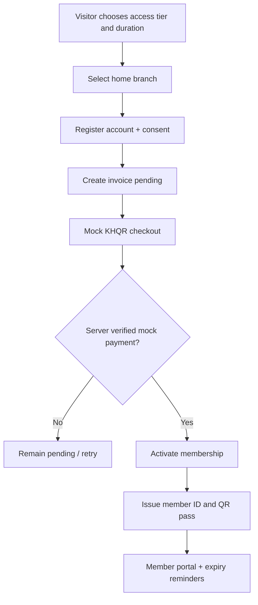

# SYSTEM.md — IronLotus Multi-Branch Membership SaaS

> Operational gym platform with one membership across six branches, access control, classes, waitlists, trainer bookings, renewal and owner analytics. Includes a secure Telegram mini-app, using fake data and mock payments.

## Domain boundaries and roles

**Multi-branch, one gym organization:** seed one fictional operator with six branches; design `organization_id` on core records so future organizations can be isolated. Every staff API filters by organization AND branch membership. All-club memberships may check into any branch inside their org; Home Club memberships only the chosen home branch.

| Role | View/action scope |
|---|---|
| Visitor | Public plans/branches/classes and demo sign-up |
| Member | Own plan, short-lived QR, check-in history, class booking/waitlist, PT sessions, billing |
| Reception | Scan QR, see only necessary member identity and photo, register visits for staffed branches, renew with permission |
| Trainer | Own sessions/classes/attendance, class roster with minimum necessary fields |
| Branch manager | Branch members, occupancy, schedules, freezes, operational reporting |
| Owner | All branch KPIs, plans, staff roles and organization settings |

**Screens:** `/app/reception`, `/app/members`, `/app/members/[id]`, `/app/plans`, `/app/classes`, `/app/classes/[id]`, `/app/trainers`, `/app/reports`, `/app/settings`; member pages as in website.

## Workflow 1 — Join, pay, activate

Only verified mock server completion activates plan. Store start `activated_at` and exact expiry (month-based calendar math at Phnom Penh time, define inclusive/exclusive period clearly). Do not create duplicate active periods on payment retry. A member may renew before expiration: append a new consecutive term from current expiry; if already expired, term begins at successful renewal. Membership billing and membership access are separate domain objects.

## Workflow 2 — Short-lived QR front desk check-in

1. Logged-in member opens `/member/qr` or Telegram mini app. Backend signs one-time pass containing `member_id, nonce, exp <= 60 sec`, not raw PII.
2. Front-desk staff uses camera scanner/typed fallback on `/app/reception`, submits signed token.
3. API verifies signature, expiry, nonce not reused, member active, not frozen, branch access allowed, branch open for demo, and no duplicate scan inside configured cooldown (e.g. 10 min).
4. API returns `GRANTED` green plus text `Access granted`, sample avatar, member nickname and plan expiry; or `DENIED` red plus precise reason `Expired`, `Frozen`, `Wrong branch`, `Invalid pass` (avoid revealing member details for invalid token).
5. Persist check-in and update occupancy counter; an optional exit scan subtracts occupancy, preventing negative counts.

### State machines

Membership: `PENDING_PAYMENT -> ACTIVE -> EXPIRED`; `ACTIVE -> FROZEN -> ACTIVE` with saved start/end freeze, `ACTIVE -> CANCELLED` with owner-approved adjustment. `EXPIRED -> RENEWED` creates **new term**, not overwrite history. Store immutable membership history.

Check-in: `GRANTED/DENIED`, with reason; never write a `GRANTED` row if no valid membership. QR nonces consumed once.

## Workflow 3 — Classes, booking and waitlist

Classes are templates (`Strength Basics`, etc.) generating branch-specific class sessions with trainer, room, start/end and `capacity`. Member chooses session; transaction confirms capacity and plan eligibility, inserts booking `BOOKED`. When full, member may `WAITLISTED` with position. Cancellation frees seat; first eligible waitlisted member is promoted atomically and notified through demo Telegram outbox. Prevent duplicate active bookings, past-session registration and overlapping member bookings. Trainer cannot be scheduled in two locations at the same time; same room can't host overlapping sessions. Class no-show and attendance status recorded by staff.

**PT packages:** member purchases a demo package of 4/8 sessions, holds credit balance; book trainer time (must be free), deduct one credit only when session completed or enforce documented cancellation rules (suggest: cancel >=12 hours -> credit returned; late cancel -> credit consumed with reason). Never allow credits < 0.

## Workflow 4 — Freeze, reminders, renew

An eligible 6-month plan gets one 7-day freeze, 12-month two 7-day freezes; shorter plans none unless manager override. A freeze pauses check-in and extends expiry by actual frozen days; cannot overlap existing freeze or start after expiry. Manager sees reason/audit. Scheduler emits expiration notices at 7/3/1 days, class notices 24 hours prior, and waitlist promotions into outbox only once each `(member,event,scheduled_day)`. Member can renew via mock payment.

## Data tables

| Table | Critical fields/constraints |
|---|---|
| `organizations` | id, legal_demo_name, enabled |
| `branches` | org_id, code, name, example_area, demo_hours, UNIQUE(org_id,code) |
| `users`, `staff_assignments` | user_id, org_id, branch_id, role, active |
| `members` | org_id, user_id, alias, demo_photo_key, home_branch_id, public_member_code UNIQUE |
| `plans` | access_scope `HOME/ALL`, duration_months, price_minor, freeze_allowances, active |
| `memberships` | member_id, plan_snapshot, home_branch_id, started_at, expires_at, state, version, payment_id |
| `membership_freezes` | membership_id, start_at, end_at, status, approved_by, reason |
| `payments`, `invoices` | reference, member_id, amount, paid_status, unique idempotency key |
| `qr_nonce_uses` | member_id, nonce_hash UNIQUE, expires_at, scanned_branch_id |
| `checkins` | member_id, branch_id, result, reason, scanned_by, entered_at, exited_at NULLABLE |
| `class_templates` | name_i18n, description_i18n, length_min, image_key |
| `class_sessions` | branch_id, trainer_id, room_id, start_at, end_at, capacity, status |
| `class_bookings` | member_id, session_id, status, waitlist_position, booked_at; UNIQUE active pair |
| `trainers`, `rooms`, `pt_packages`, `pt_session_bookings` | trainer capacity and session-credit linkage |
| `notification_outbox`, `audit_events` | deduplication keys and identity logs |

Indices: active membership `(member_id,expires_at)`, checkins `(branch_id,entered_at)`, sessions `(branch_id,start_at)`, class bookings `(session_id,status,booked_at)`.

## APIs

Public: `GET /v1/branches`, `GET /v1/plans`, `GET /v1/classes?branch=&date=`, `POST /v1/members/signup`, `POST /v1/billing/mock-checkout`.

Member: `GET /v1/me/membership`, `POST /v1/me/qr-pass`, `GET /v1/me/checkins`, `GET /v1/me/classes`, `POST /v1/me/class-bookings`, `DELETE /v1/me/class-bookings/{id}`, `GET /v1/me/waitlist`, `POST /v1/me/renew`, `POST /v1/me/freeze-request`, `GET /v1/me/pt-credits`, `POST /v1/me/pt-bookings`.

Staff: `POST /v1/reception/checkin`, `POST /v1/reception/checkout`, `GET /v1/staff/members`, `PATCH /v1/staff/memberships/{id}`, `GET/POST/PATCH /v1/staff/class-sessions`, `POST /v1/staff/class-sessions/{id}/attendance`, `GET /v1/reports/memberships`, `/v1/reports/occupancy-heatmap`, `/v1/reports/churn`, `/v1/reports/revenue`.

Telegram mini-app: `POST /v1/auth/telegram/verify-init-data` verifies Telegram hash server-side and binds only explicit test user consent, then issues scoped token. Don't trust `initDataUnsafe`; don't send full medical/biometric data to Telegram.

## Owner dashboard definitions

- `Active members`: distinct member IDs with at least one current `ACTIVE` membership, optionally by home branch or check-in branch; label selection clearly.
- `Expiring in 7 days`: current active expiry in interval; frozen extended dates respected.
- `Revenue`: verified mock paid invoices minus refunds in selected period, by branch of sale.
- `Hourly check-in heatmap`: actual granted check-in counts bucketed local hour/day/branch; not continuously occupied members.
- `Churn`: members with term ending in period who had no renewal within configurable 30-day grace period / members with terms ending in period (label as demo metric).
- `Class attendance`: attended / booked slots (exclude cancelled).

## Seeded showcase states

6 branches, 8 plans, 120 fictional adult members, 6 managers, 8 receptionists, 8 trainers, 500 check-in events/30 days, 60 scheduled sessions, 10 waitlist entries, 8 members expiring soon, frozen member, expired member and member attempting wrong branch. One 6-month member can freeze. One class has full capacity and a waitlist. Every branch has real seeded independent occupancy/reporting.

## Edge cases and tests

Expired/frozen/wrong branch pass -> denied; token reuse -> denied; tampered token -> denied; concurrent scan -> only one grant; renewal double callback -> one new term; freeze extension exact even with month boundaries; simultaneous last seat booking -> one seat, one waitlist; cancelled first-seat promo only once; trainer double booking blocked; member only sees own records; staff cannot access other branch.

## Development delivery

**Phase A:** auth, role/branch scope, plans, payments, member signup. **Phase B:** short-lived QR, reception scan, check-in state, histories. **Phase C:** classes/trainer calendars, caps, waitlist, PT. **Phase D:** freeze/renew/outbox, reporting, Telegram mini-app. **Phase E:** complete brand website, Khmer, tests, seed reset and case study.

**Demo script:** Join at BKK1 with all-club plan, mock-pay, scan at Toul Kork successfully, book Strength Basics, join waitlist for a full session, cancel another booking, show reminder preview and owner's 6-branch KPIs.
