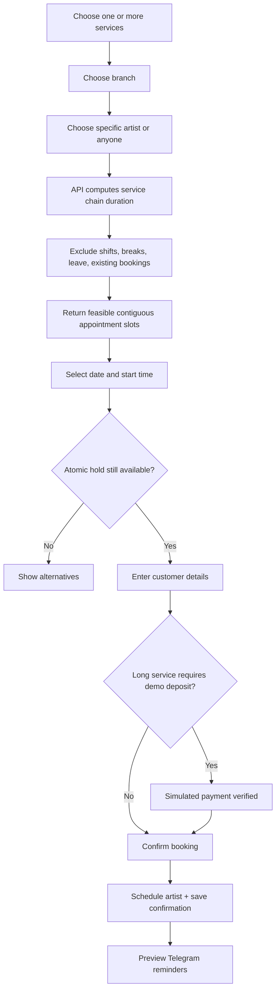

# SYSTEM.md — Lumière Booking, Scheduling, Customer Profiles and Commission

> End-to-end three-branch salon system using web + verified Telegram mini app, transaction-safe staff calendars, service sequencing, optional mock deposit, reminders, customer visit records, stylist commissions and gift cards.

## Actors / systems

| Actor | Screens and permissions |
|---|---|
| Visitor/customer | Public site and `/my-bookings`; book, manage own appointments via token/login, view loyalty/gift cards |
| Receptionist | `/app/appointments`, `/app/customers`, `/app/checkout`; booking edits, arrivals, checkouts for assigned branch |
| Stylist/artist | `/app/my-calendar`, `/app/my-clients`; own scheduled appointments, service notes with allowed visibility |
| Branch manager | `/app/calendar`, `/app/staff`, `/app/services`, `/app/reports`; configure break times, leave, services and discounts |
| Owner | `/app/dashboard`, `/app/commissions`, `/app/branches`; all branch settings and role grants |

No stylist may see customer data for another branch/artist without policy; restrict notes to assigned professionals and managers. For demo, all customer identities are fake.

## Workflow A — Multi-service booking and availability

**Slot algorithm:** for each candidate start time at 15-min increments, construct booked service chain in selected order and combined duration, plus cleanup buffers (default 15m; customizable per service). Match every segment to a qualified on-shift artist if `anyone`, with branch scope, equipment/room availability if required, blocked intervals and days off; require **contiguous time** for a single artist or documented coordinated multiple artists. To keep MVP understandable, restrict one appointment to one artist unless an explicitly qualified multi-artist rule is configured. Candidate slot must end before shift/closing time. Recalculate under transaction lock (Postgres advisory lock or slot exclusion constraint) at confirmation. A stale slot cannot double-book.

**Long services:** total duration >=120 minutes require 20% **mock** deposit; amount rounded to minor units. Booking remains `HOLD/PENDING_DEPOSIT` until verified mock checkout; hold expires after five minutes. No payment = no confirmed slot. Cancellation/refund policy **sample**: cancel >24h before gets demo deposit refunded; <=24h manager decides, logged. Clearly label policy illustrative.

## Workflow B — Calendar operations

Staff calendars day/week; columns by stylist with appointment cards colored and labeled `Booked`, `Checked in`, `In service`, `Completed`, `Cancelled`, `No-show`. Drag to another stylist/time invokes `PATCH /appointments/{id}/reschedule` with `expected_version`; API validates all eligibility/conflicts first, then persists and logs event; drag alone must not commit. Configurable shifts, blocked lunch breaks, holidays and leave. Manager can mark break or absence which must not silently cancel already confirmed appointments—show conflict resolution queue.

Appointment state transitions: `HELD -> PENDING_DEPOSIT -> CONFIRMED -> CHECKED_IN -> IN_SERVICE -> COMPLETED`; from confirmed `CANCELLED` or `NO_SHOW`. Only completed service lines enter commission calculation; management may manually waive with audit.

## Workflow C — Customer profiles, checkout, loyalty

Reception checks in customer, optionally appends private visit notes and fictional hair color formula, marks services complete, adds retail item if purchased, takes mock cash/KHQR payment for remaining invoice. Profiles show visits, preferred artist, demo notes, purchase history, points ledger. Example rewards policy: one point per $1 verified paid **eligible service spend** (floor USD amount) and 50 points = $5 demo discount; reward discount is recorded as liability adjustment with no double counting; refunds reverse earned points. Gift cards are value ledger: purchase generates cryptographically random sample code, redemption decrements balance transactionally, concurrent redemption cannot overdraw. For public demos, no real third-party delivery or money.

## Workflow D — Commission and reminders

Service commission defaults 15% for artists, manager configurable per service/stylist effective date. Commission amount = completed service net sales after item-specific discounts, excluding taxes and retail items (unless separate retail commission rule). Assign per line to stylist who performed service. Locked monthly commission statements; corrections via adjustment entries with reason, not edited history. Reminder outbox created 24h and 2h before appointments, and cancellation/reschedule message event preview. Deduplicate by booking, event type and intended send time.

Telegram mini app: verify Telegram initData signature on server, map to opt-in **test** customer account only, then deep link to own bookings, modify selected appointments and show gift-card/points. No automatic unsolicited messages.

## Data model

| Table | Essential schema / constraints |
|---|---|
| `branches` | name, hours, timezone, demo address text |
| `services` | category, localized name/description, duration_min, buffer_min, price_minor, requires_room, active |
| `staff` | branch_id, user_id, fictional display name, skill tags, pay_rate/commission policy |
| `staff_skills` | UNIQUE(staff_id,service_id), enabled |
| `staff_shifts`, `staff_breaks`, `staff_leave` | start/end timestamps, recurrence where appropriate, effective dates |
| `resources` | room/chair/equipment, branch_id, resource_type, capacity |
| `customers` | demo alias, email `.example`, test Telegram id, preferred_artist_id NULLABLE |
| `bookings` | id, public_ref, customer_id, branch_id, staff_id, starts_at, ends_at, state, mock_deposit_due_minor, hold_expires_at, management_token_hash, version |
| `booking_services` | booking_id, service_id, sequence, start/end, price_snapshot, assigned_staff_id, status |
| `service_resource_allocations` | booking_service_id, resource_id, start/end, exclusion constraint |
| `customer_visit_notes` | booking_id, author, allowed_staff_group, encrypted_text, timestamp |
| `payments`, `invoices`, `retail_items`, `retail_sales` | amounts and link to booking/customer, payment status |
| `loyalty_entries`, `gift_cards`, `gift_card_ledger` | auditable balance deltas, unique redemption references |
| `commission_rules`, `commission_entries`, `commission_statements` | effective dates, basis, status, adjustment reason |
| `audit_events`, `outbox_notifications` | state trace and reminders |

Use unique booking ref and idempotency key; indexed `bookings(branch_id,staff_id,starts_at)`, constrained overlapping intervals for **confirmed** and held bookings. Avoid customer identity collisions by demo account ID, not nickname matching.

## APIs

Public: `GET /v1/services?branch=`, `GET /v1/staff?branch=&service=`, `POST /v1/availability/search` (services, branch, staff preference, date), `POST /v1/bookings/hold`, `POST /v1/bookings`, `GET/PATCH /v1/bookings/manage/{token}`, `GET /v1/branches`, `POST /v1/gift-cards/demo-purchase`.

Customer: `GET /v1/me/bookings`, `POST /v1/me/bookings/{id}/cancel`, `GET /v1/me/loyalty`, `GET /v1/me/gift-cards`, `POST /v1/auth/telegram/verify-init-data`.

Staff: `GET /v1/staff/calendar?branch=&day=`, `POST /v1/staff/shifts`, `POST /v1/staff/blocks`, `PATCH /v1/appointments/{id}/reschedule`, `PATCH /v1/appointments/{id}/state`, `POST /v1/appointments/{id}/complete`, `POST /v1/checkout/{booking_id}`, `GET /v1/reports/stylists`, `GET /v1/reports/commissions`, `POST /v1/admin/commission-rules`.

## Dashboards and screens

- **Calendar:** time grid with stylists as columns, day/week toggle, service colors with text/ARIA labels, drag/drop confirmation; appointment drawer with client, services, projected finish, deposit, notes; no overlapping cards.
- **Customer CRM:** search sample alias, visits and spending, preferred stylist, points, appointment history, notes with disclosure and scope restriction.
- **Commission:** per-stylist totals, services, retail add-ons, rule snapshots, commission statement export CSV; owner may issue adjustment with reason.
- **Revenue:** day/branch/stylist, utilization = booked service minutes / available on-shift service minutes, no-show rate, busiest weekday, mock product sales, future bookings, deposits outstanding.

## Seeds

3 branches; 9 fictional staff/stylists; 9 listed services; configurable opening hours; 120 demo customers; 180 bookings spanning previous 30 days and next 2 weeks; 25 sales, 10 gift cards, 20 commission lines, 1 full stylist calendar, 1 long appointment needing deposit, 1 rescheduling collision, 1 artist on leave, 1 customer with 40 loyalty points.

## Critical test matrix

Concurrent last slot: one confirmed; deposit callback replay: one payment/booking; booking with two services: duration + buffer correct; holiday, break and off-shift slot: unavailable; stylist lacks qualification: cannot assign; drag into conflict: rejected with old booking preserved; cancellation creates free slot; gift-card concurrent redeem: never negative; commission on cancelled service: zero; cross-branch/other-stylist notes: forbidden; Telegram initData altered: rejected.

## Implementation order and final demo

1. Branch/services/staff skills and schedules, then slot engine with unit tests.
2. Web wizard, hold + deposit mock, confirmation/manage link.
3. Staff calendar, drag rescheduling, customer profiles, checkout.
4. Loyalty, gift cards, commissions, reminders, Telegram mini app, analytics.
5. Accessibility, i18n, security audit, demos/seed reset and E2E.

**End-to-end scenario:** visitor books Haircut + Conditioning at BKK1 with any qualified artist, receives demo confirmation, receptionist checks in, stylist completes services, cashier records simulated payment, visit/loyalty and commission entries appear in respective dashboards.
