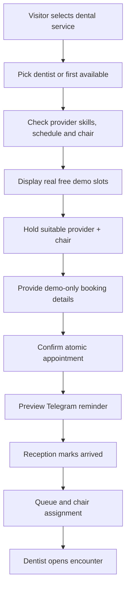

# SYSTEM.md — SmileNova Clinic Operations, Records and Tooth Chart

> Demonstrate a record-heavy dental clinic system with appointment/chair scheduling, arrival queue, confidential synthetic patient chart, 32-tooth adult FDI odontogram, multi-visit treatment plan, installments and invoice PDFs. **Never process actual patient records in public demo.** This is administrative software, not AI diagnosis.

## System roles and privacy boundaries

| Role | Access |
|---|---|
| Public visitor | Browse services, check slot availability, create/manage own fictional appointment with opaque token |
| Patient account (demo) | Only assigned synthetic appointment, approved summaries, sample invoices and payment history |
| Reception | Schedule, check in, view basic contact and billing details; **not full dentist-only clinical notes** |
| Dentist | Own assigned patient encounters, tooth chart, medical history checklist, visit notes and treatment plan |
| Dental assistant | Assigned chair status and limited visit-task information; no full private notes unless explicitly delegated |
| Cashier | Invoices, payments, balances, no detailed diagnoses or medical history |
| Clinic manager/owner | Operational KPIs and staff/resource settings; clinical notes access only if separately granted as qualified care role |

Build all clinical endpoints with authorization, audit of **reads and writes**, sample consent flag and least privilege. No external LLM API, analytics trackers or logging of clinical notes. Uploaded mock X-rays stored private behind short-lived signed links.

## Workflow 1 — Appointment, dentist and chair allocation



For each service use sample duration: checkup 30m, scaling 45m, filling 60m, consultation 45–60m, + cleanup 10m. A booking must reserve a dentist and qualified chair/room without overlap; concurrent booking collisions rejected. Public customer should see no patient names. Walk-ins enter triage-less waiting queue (do not assign urgency medically); staff chooses chair when available. Booking state: `PENDING → CONFIRMED → ARRIVED → IN_CHAIR → COMPLETED`, and `CANCELLED`, `NO_SHOW` alternate paths. No automatic medical decisions.

## Workflow 2 — Patient chart and encounters

After reception checks patient in, assigned dentist opens a new encounter, reviews **fabricated** patient history checklist, adds notes and associates tooth events. Medical history inputs only within authenticated staff EHR, never an untrusted public free-text booking form. Structured fields example: history category, yes/no/unknown, date recorded, source, review acknowledgement. Append changes as versioned medical history records; no silent overwrites. Use note authorship, amendment links, created/updated timestamps and access audit.

### Interactive 32-tooth adult odontogram

Use native SVG with clickable teeth, accessible list/form fallback, clear hover/focus and selections. **FDI numbering**:

```text
Upper right: 18 17 16 15 14 13 12 11 | Upper left: 21 22 23 24 25 26 27 28
Lower right: 48 47 46 45 44 43 42 41 | Lower left: 31 32 33 34 35 36 37 38
```

Implement `Normal`, `Caries`, `Filling`, `Crown`, `Root canal`, `Missing/Extracted`, `Needs review` as **manual dentist-entered states**, plus tooth surface/notes when relevant. A tooth may have event history; present current summary derived from latest signed/active event rather than overwrite the record. Show explicit legend/text labels (not color alone), timestamps and source dentist. Include `Undo last unsaved edit`, `Save encounter`, and compare selected tooth history. Dentist cannot mark a chart for a patient not assigned to them without manager-approved clinical reassignment. Design explicitly **no automated diagnosis**.

## Workflow 3 — Multi-visit treatment planning and bills

Dentist creates plan title (e.g., `Illustrative orthodontic follow-up`), objectives, phases, proposed treatment codes, linked tooth(s), estimated quantity, cost per item and number of visits. Example schedule over 18 months is a **hypothetical billing/timeline illustration, not actual prescription**. Patient approves a demo estimate acknowledgment; only dentist confirms clinical plan. Reception schedules future appointments; billing creates invoice with unique number and detailed line items, issues mock KHQR/cash payments, records installments and balance. Partial payment reduces `amount_due` but does not mark paid until zero. Refunds preserve ledger history.

Treatment plan states `DRAFT → PRESENTED → ACKNOWLEDGED → ACTIVE → COMPLETED`; alternate `DECLINED` / `CANCELLED` with reason, and revisions create new immutable version of plan. Visits link completed service line to invoice and tooth event where applicable. Generate **demo PDF** with non-identifying patient alias and bold `FICTIONAL DEMO — NOT A CLINICAL DOCUMENT` watermark.

## Workflow 4 — Reminder / file handling

Appointment reminders 24h and 2h before into simulated Telegram outbox. Private mock X-ray attachment must validate MIME (JPEG/PNG/PDF), max size e.g. 10 MB, ownership and server-side storage key. Only authorized assigned clinical staff get signed read URLs; avoid public bucket access, cached thumbnails or exposing URLs in logs. Implement file deletion/retention policies with audit; no user-supplied real scans.

## Database model

| Table | Essential fields and invariants |
|---|---|
| `clinics`, `rooms`, `chairs` | clinic id, room, chair state, equipment flags, active |
| `providers`, `provider_services`, `provider_shifts` | role, qualification **demo-only**, eligible service, availability |
| `patients` | pseudonymous alias, internal patient number, demo contact, synthetic flag=true, consent timestamp |
| `appointments` | service_id, provider_id, chair_id, patient_id, start/end, status, secure_manage_token_hash, version |
| `checkin_queue` | patient_id, appointment_id NULLABLE, arrival_at, queue_state, chair_assigned_at |
| `medical_history_answers` | patient_id, category, answer, note_encrypted, captured_by, valid_from, supersedes_id |
| `encounters` | patient_id, appointment_id, assigned_dentist_id, started_at, finished_at, status, signed_at |
| `encounter_notes` | encounter_id, dentist_id, encrypted_body, version, amended_from_id, signed_at |
| `tooth_events` | patient_id, encounter_id, tooth_fdi, surface NULLABLE, event_type, manual_status, note, author_id, timestamp, supersedes_id |
| `treatment_plans` | patient_id, dentist_id, version, title, stage, estimated_total_minor, created_at |
| `plan_items`, `planned_visits` | service/type, tooth_fdi optional, proposed_date, amount_minor, state, invoice_line_id optional |
| `invoices`, `invoice_lines`, `payments`, `payment_allocations` | patient pseudonym, money accounting, balance, idempotency |
| `attachments` | patient_id, encounter_id, private storage key, kind, sha256, upload_by, created_at |
| `record_access_audit`, `audit_events`, `outbox_notifications` | access purpose, user and immutable event metadata |

Use UUID primary keys, table scope, FDI value CHECK for only 32 allowed adult codes, nonnegative balances, indexed appointments `(provider_id,start_at)`, `(chair_id,start_at)`, tooth history `(patient_id,tooth_fdi,created_at)`. Adopt transactional exclusion constraints for provider/chair times.

## API specification

**Public:** `GET /v1/dental/services`, `GET /v1/dental/providers`, `GET /v1/appointments/slots?service=&provider=&date=`, `POST /v1/appointments/holds`, `POST /v1/appointments`, `GET/PATCH /v1/appointments/manage/{token}`.

**Reception:** `GET /v1/reception/schedule`, `POST /v1/reception/walk-ins`, `PATCH /v1/reception/appointments/{id}/arrive`, `POST /v1/reception/chair-assignments`.

**Dentist:** `GET /v1/clinical/patients/{id}/summary`, `POST /v1/clinical/encounters`, `GET /v1/clinical/encounters/{id}`, `POST /v1/clinical/encounters/{id}/notes`, `GET /v1/clinical/patients/{id}/odontogram`, `POST /v1/clinical/encounters/{id}/tooth-events`, `GET/POST/PATCH /v1/clinical/treatment-plans`, `POST /v1/clinical/attachments`, `GET /v1/clinical/attachments/{id}/signed-download`.

**Billing:** `POST /v1/billing/invoices`, `POST /v1/billing/payments/mock`, `POST /v1/billing/invoices/{id}/allocate`, `GET /v1/billing/invoices/{id}.pdf`, `GET /v1/reports/financial`. Patient portal `/v1/patient/me/appointments`, `/v1/patient/me/plan-summaries`, `/v1/patient/me/invoices` guarded to own record.

## UI/analytics

**Reception board:** Today appointments, chair occupancy, arrivals/waiting, missing confirmations, actions with no clinical details. **Dentist chart screen:** patient alias + visit header, clickable SVG 32-teeth and text fallback, conditions legend, event history, note editor, save/sign. **Treatment planner:** phases with estimated amounts, appointment timeline, patient-readable print preview. **Billing:** invoices, partial payments, outstanding amount, CSV demo export. **Dashboard:** appointments today, revenue (verified mock collections), unpaid balances, treatments by category, chair utilization calculated from occupied time vs scheduled open-chair time. Only non-sensitive aggregates visible to owner by default.

## Seed scenarios

Create 2 fictional clinics if desired (one sufficient for MVP), 3 dentists, 3 chairs, 12 sample services/consultation types, 50 **synthetic** patient aliases (not real people), 70 appointments, 40 encounters, 100 tooth events across different FDI teeth, 10 illustrative plans, 20 invoices with full/partial payments, 8 private dummy X-ray illustrations/placeholder scans clearly labeled fake. One example chart: tooth 16 caries (manually recorded), tooth 36 filling history then crown proposed, tooth 48 marked extracted/missing. All records `synthetic=true` and bannered.

## Tests and safety gates

- Double-book dentist or chair -> rejection; walk-in occupies a chair -> affects availability; receptionist cannot GET dentist notes; dentist assigned to patient A cannot fetch B by changing ID; patient A cannot fetch B invoices; owner dashboard cannot access clinical notes without separate clinical role.
- Upload executable/misleading extension/oversize -> reject; attachment URL expires; chart invalid FDI code -> 422; unauthorized chart edit -> 403; signed note amended via version (not destructive edit); signed clinical events audit.
- Partial payment math exact; repeated mock callback idempotent; plan versions immutable; reports sourced from fake database, no real clinical integrations; public page offers no diagnosis.

## Build phases / acceptance

1. Auth, clinical permissions, pseudonymous seed patients, service/provider/chair availability.
2. Booking, reception queue, patient profiles, encounters and protected notes.
3. Tooth SVG (32 FDI) with append-only events and accessible fallback.
4. Treatment plans, invoices, installments, watermarked demo PDFs, mock attachments.
5. Telegram preview, dashboard, privacy/security tests, locales, polish and documentation.

**Demo:** visitor books a checkup; reception checks in and assigns chair; dentist records a manual tooth event and sample plan; cashier collects one mock installment; PDF invoice downloads; record access audit proves staff scopes. **Not a functioning clinical service.**
