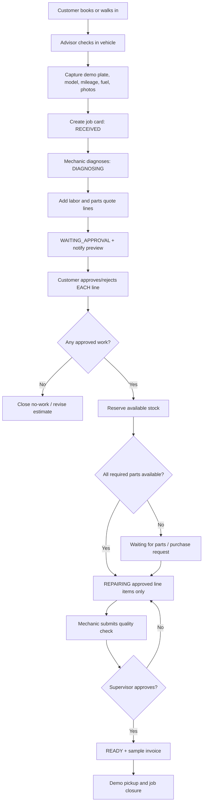

# SYSTEM.md — PitStop Garage Job Card, Quote Approval, Repair Tracking and Parts

> Multi-stage repair work management for a fictional garage. The main success criterion is an authenticated staff workflow and secure customer tracking link where **each quote line** can be accepted or rejected before work begins.

## Roles and modules

| Role | Actions / screens |
|---|---|
| Visitor | Public pages, create sample service booking |
| Customer | Track own authorized job, approve/decline quoted line items, see completed jobs and invoices for own vehicles |
| Reception / Service advisor | `/app/checkin`, `/app/jobs`, customer/vehicle registry, share token, create quote |
| Mechanic | `/app/my-jobs`, findings/photos, labor progress, parts request, quality-check submission |
| Parts clerk | `/app/inventory`, receive/adjust/reserve stock, stock alerts |
| Supervisor | `/app/approvals`, quality-check, quote revisions and exceptions |
| Owner | `/app/dashboard`, `/app/staff`, `/app/services`, cost and performance reports |

**Confidentiality:** Plate number does **not** authenticate identity. For history use account and verified demo vehicle ownership; share repair status via **long unguessable expiring tracking token** tied to one job. Rotate and revoke tokens at will. Public track reference only returns generic `link required`.

## Workflow 1 — Vehicle check-in to repair completion

Job status persisted as `RECEIVED → DIAGNOSING → WAITING_APPROVAL → REPAIRING → QUALITY_CHECK → READY → COLLECTED/CLOSED`; alternative `WAITING_PARTS` with return to `REPAIRING`; supervisor can `CANCELLED` with reason when no work; any rework cycles `QUALITY_CHECK → REPAIRING` logged. Every change writes `job_status_log` and notification to simulated Telegram outbox. Technician updates must use expected version or lock, and unauthorized status jumps are rejected.

### Quote-level states and customer approval

Line statuses: `DRAFT → PENDING_APPROVAL → APPROVED/DECLINED`, then `APPROVED → RESERVED/IN_PROGRESS/COMPLETED`. Revised prices create **new version** requiring fresh explicit approval, not mutate approved amount. Quote approval link shows work description, quantity, unit/line parts cost, labor, total, optional photos and risk note (plain language). Customer presses Approve/Decline per item. Server validates `secure_token + quote_version + idempotency_key`, records timestamp and customer demo identity/approval method. **No work-order execution or part consumption on a declined or pending line.** Mixed decisions supported. When all required decisions complete, advisor may advance job with only approved scope; late added items require separate approval.

## Workflow 2 — Inventory and part reservation

Mechanic selects part SKU + quantity to quote; stock clerk sees `(available, reserved, on_hand, reorder_threshold)` by branch/store. On customer approval and job start, reserve quantities atomically; upon installing the part, post a stock movement `ISSUE` linked to job/quote line. Cancelled job releases unconsumed reservations, never creates stock. Out-of-stock part switches item to `WAITING_PARTS`, with manager alert; optionally procure then receive stock movement (`RECEIPT`) before starting. Negative stock blocked except authorized audit adjustment with reason.

Inventory is not allowed to count declined quote parts as consumed. Transaction currency is illustrative USD; inventory acquisition cost and customer sale price stored separately.

## Workflow 3 — Service history and reminder

Vehicle record keyed by stable internal `vehicle_id`, with plate stored as a searchable attribute. Same plate can change/reassign over years; do **not** equate plate with customer ownership automatically. Job closure saves odometer, services, billed amounts and sample next due date/mileage according to configured service rules (e.g., oil follow-up after sample 5,000 km/6 months; **not** universal vehicle guidance). Send opt-in simulated reminder before due date, deduplicated. An owner sees only vehicles explicitly attached to that owner account.

## Workflow 4 — Check-in photos + secure tracking

Advisor uploads synthetic arrival and damage images, label angles (`Front`, `Rear`, `Left`, `Right`, `Interior`); before/after groups are **demo examples**. Generate random >=128-bit token, store only hash server-side, e.g. expiring in 30 days or after job closure + grace period. Owner can revoke. Customer page returns only safe sanitized status, approved/declined quote lines, photos flagged `share_with_customer`, and public technician notes; exclude internal costs, parts purchase costs, staff private notes and unrelated customer info. Token must not be printed in referrer logging or analytics.

## Data model

| Table | Required fields and constraints |
|---|---|
| `customers` | id, demo alias, account_id optional, contact `.example`, synthetic=true |
| `vehicles` | id, owner_customer_id, plate_display_masked, plate_search_hash, make, model, year, VIN nullable **fake only**, odometer_current |
| `service_bookings` | customer_id, vehicle_id, requested_service, preferred_at, booking_state |
| `jobs` | id, public_reference UNIQUE, vehicle_id, branch_id, assigned_advisor_id, mechanic_id, status, customer_complaint, checkin_mileage, fuel_level, created_at, version |
| `job_photos` | job_id, storage_key, shot_angle, privacy_flag, caption, created_by |
| `job_status_log` | job_id, old_status, new_status, actor_id, occurred_at, note_public, note_private |
| `tracking_tokens` | job_id, token_hash UNIQUE, expires_at, revoked_at, created_by |
| `quote_versions` | job_id, version, submitted_at, status, subtotal_minor, approved_total_minor |
| `quote_items` | quote_version_id, description, type `PART/LABOR`, sku_id NULLABLE, quantity, unit_price_minor, decision_status, decided_at, idempotency_key |
| `parts` | sku UNIQUE, label, cost_minor, selling_price_minor, reorder_threshold, active |
| `branch_stock` | branch_id, part_id, on_hand, reserved, version; nonnegative |
| `stock_movements` | branch/part/job/quote line, qty signed, move_type, actor_id, reason |
| `job_labor_logs`, `quality_checks` | time, checklist, reviewer, pass/fail, signed_at |
| `invoices`, `invoice_lines`, `payments`, `service_reminders` | totals, balances, scheduled dates and statuses |
| `audit_events`, `outbox_notifications`, `users`, `staff_branch_roles` | shared role/audit data |

Indices: jobs `(branch_id,status,created_at)`, vehicles `(owner_customer_id)`, quote `(job_id,version)`, stock `(branch_id,part_id)`, movements `(part_id,created_at)`. Mask stored plates in customer and UI where possible; sample plate data only.

## APIs

Public: `GET /v1/services`, `POST /v1/bookings`, `GET /v1/tracking/demo`, `GET /v1/tracking/{secure_token}`, `POST /v1/tracking/{secure_token}/quotes/{line_id}/decision`, `GET /v1/tracking/{secure_token}/timeline`.

Customer: `GET /v1/me/vehicles`, `GET /v1/me/vehicles/{id}/history`, `GET /v1/me/jobs`, `GET /v1/me/invoices`.

Staff: `POST /v1/checkins`, `GET /v1/jobs?branch=&status=`, `PATCH /v1/jobs/{id}`, `POST /v1/jobs/{id}/photos`, `PATCH /v1/jobs/{id}/status`, `POST /v1/jobs/{id}/quotes`, `POST /v1/jobs/{id}/quotes/{version}/submit`, `POST /v1/jobs/{id}/tracking-link/rotate`, `POST /v1/inventory/receipts`, `POST /v1/inventory/reservations`, `POST /v1/inventory/issues`, `GET /v1/inventory/low-stock`, `POST /v1/jobs/{id}/quality-check`, `GET /v1/reports/jobs`, `/v1/reports/revenue`, `/v1/reports/mechanics`.

Emit realtime events `job.status_changed`, `quote.submitted`, `quote.item_decided`, `part.low_stock`, `quality_check.completed`, `invoice.created` to authorized recipients; demo outbox logs Telegram-style messages with deep links.

## Screen designs and business KPIs

**Check-in form:** car select/new with fictional plate validation (accept demonstration format but don't claim universal Cambodian plates), make/model, mileage, fuel-level slider, arrival photos, customer complaint, service adviser, initial inspection checklist. `Create Job Card`.

**Job board:** Kanban statuses with card code, car, elapsed time, mechanic, amount awaiting approval, parts pending; drag must run server transition validation (not directly change DB). **Job detail:** audit timeline, internal/public notes separated, images, versioned quote table, inventory reservations, mechanics log and approval banners.

**Customer tracking:** mobile-friendly progress stepper, secure quote approval, photos and status history; no login if valid token, privacy-limited. **Inventory:** part search, on-hand vs reserved/available, reorder alerts and movement history. **Owner reports:** completed jobs by mechanic, median/average turnaround `checkin→ready`, net demo revenue paid minus refunds, outstanding estimates, top service types, stock below threshold, conversion approved quote lines/total quoted lines.

## Fake data seed

3 mechanics, 2 advisors, 1 stock clerk, 1 supervisor, 1 owner; 60 customer aliases, 75 synthetic vehicles, 110 jobs over 60 days, 25 parts SKUs, stock receipts/issues, 20 quote sets, one mixed approval, one revised quote, one missing part, one failed QC return loop, one Ready job, one revoked and one expired tracking token, one low-stock alert, sample `PS-1042` tracking page.

## Tests (mandatory)

- Reference number alone reveals no job data; valid token only grants one job; revoked/expired token rejects; another user's history inaccessible; public cannot see internal cost or private comments.
- Double click approval idempotent; changed quote price invalidates prior authorization; declined item cannot be consumed from stock or marked repaired; mixed quote transitions correctly; mechanic cannot self-approve QC if policy requires supervisor.
- Concurrent stock reservations never oversell; cancellation releases remaining reserved quantity; inventory movements reconcile on-hand; zero or negative qty invalid; wrong branch staff cannot edit job.
- State skips invalid; duplicate status action no duplicate notification; no real Telegram messages; audit trail preserved.

## Delivery phases / demo path

1. Roles, vehicles/customers, booking/check-in and job board.
2. Quote versions and secure customer per-line approval with token.
3. Parts inventory, stock reserve/issues, waiting for parts, QA loop.
4. Tracker events, demo Telegram outbox, service history/reminders, invoices and KPIs.
5. Website copy/visuals, mobile screens, Khmer support, comprehensive E2E/README.

**Main demo:** advisor checks in an invented car, technician diagnoses, customer approves brake pads but rejects air filter, system reserves only brake pads, mechanic repairs, QC passes, ready notification previews and sample invoice appears. Plate alone never unlocks job.
