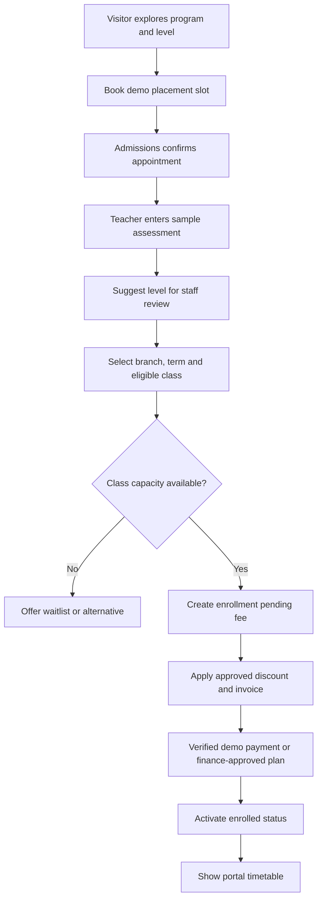
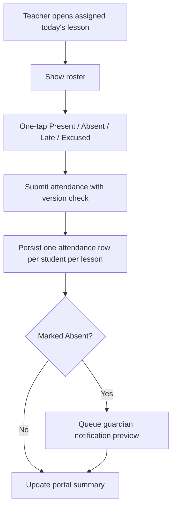

# SYSTEM.md — BrightBridge School Enrollment, Attendance, Fees and Parent Portal

> Two-branch school-management demo handling placement appointments, learners and guardians, terms, levels and classes, teacher attendance, fee invoices, grades, PDF term reports, announcements and a permission-checked Telegram mini app. Use **synthetic learners**, never real children's data.

## Roles, data rights and screens

| Role | Access / primary screens |
|---|---|
| Public applicant / guardian | View available programs/slots; create demo placement/enrollment inquiry |
| Student (demo) | Own timetable and released grades only, where account provisioned |
| Guardian | Only **explicitly linked** children: schedule, attendance, published results, invoices, announcements, mock payment |
| Teacher | Assigned class roster; mark attendance and enter provisional scores for assigned classes; never see unrelated guardian billing |
| Admissions / receptionist | `/app/admissions`, `/app/students`, `/app/placements`; manage enrollment/guardians with permission |
| Finance | `/app/finance`; invoices, discounts, payments and receivables, no unrestricted student assessment notes |
| Branch manager | `/app/classes`, `/app/schedule`, `/app/reports` for own branch |
| Owner / administrator | `/app/dashboard`, branch settings, programs, users/roles, global KPIs and audit |

**Privacy:** Use synthetic names/aliases. For minors, guardians must be linked via verified test relationship, not a guessed email/name. Portal access checks relationship status on every request. Teachers should only see information needed for attendance and grading; invoice access belongs to finance/guardian.

## Workflow 1 — Placement to enrollment

Placement is **not automated diagnosis of proficiency**; a fictional teacher records sample component scores and human confirms suggested level. If placement not needed for a particular program, admit with manually chosen level + reason. Student class enrollment must match branch, term, age guidance (soft warning with staff override), level and capacity. Reservation of last class seat is transaction-safe. Class registration can be `INQUIRY → PLACEMENT_BOOKED → OFFERED → PENDING_PAYMENT → ACTIVE`; alternate `WAITLISTED`, `WITHDRAWN`, `COMPLETED`. Do not force real payment to activate in demo; allow finance-approved sponsored/waived path with audit.

## Workflow 2 — Scheduling and class transfers

Admin creates programs, levels, terms (start/end), rooms and weekly session patterns. Class has teacher, room, maximum capacity, branch and term. Generate lesson sessions in Asia/Phnom_Penh with holiday exclusions; prevent teacher, room or student conflicting class times. After semester starts, transfer student with atomic class capacity change and effective date; previous attendance/grades stay associated with former class; invoices adjusted only by explicit configured policy and audit. Historic roster preserved. Alert if instructor change impacts future lessons.

## Workflow 3 — Attendance by teacher and guardian notice

Default status `NOT_MARKED`, never automatically `ABSENT` just because teacher has not submitted. Deadline and late edit policy configurable; edits after publish require reason and audit; retract/change event may emit correction. Attendance percent = present + configurable late credit divided by lessons with submitted attendance for enrolled period; show denominator and policy. Guardian absence notices deduplicated per learner+lesson+event and simulated by default. Avoid wording suggesting actual child whereabouts have been verified.

## Workflow 4 — Fee invoice, sibling discount, payment

For each active/pending enrollment, finance creates term invoice with tuition line (see WEBSITE.md examples), other authorized charges, discounts and due date. Demo sibling policy: eligible **second and subsequent sibling** under same verified fake guardian group in same term receive 10% off tuition line only; no compounding with itself, override requires permission. Maintain money in minor units and store discount reason and applied rule snapshot. Fees can be partially paid; mock KHQR verified server-side, staff demo cash recorded with user audit. Past due status derived from due date and outstanding balance; retain unpaid invoice independently of class status. Refund adjustments create credit note, not erase transaction.

## Workflow 5 — Assessment, reports and level progression

Teacher creates assessment per class/term (`Quiz`, `Midterm`, `Final`, `Speaking`), weight percentages summing to 100 for published final score (sample: 20/25/35/20). Scores decimal 0–100 with rubric/comments and publication control. Result state `DRAFT → REVIEWED → PUBLISHED`; once published, student/guardian sees report. Report card PDF includes fictional learner alias, term, program/level, weighted results, attendance summary, teacher comments and a conspicuous `SYNTHETIC DEMO DATA — NOT AN OFFICIAL REPORT` watermark. **Level recommendation** may be rule-assisted (`>=70` + teacher approval suggests next level) but final decision belongs to human academic coordinator; don't auto-transfer.

## Workflow 6 — Telegram parent mini app + announcements

An explicitly connected guardian's Telegram mini app verifies signed Telegram initData on backend; exposes only linked child(ren), today/weekly timetable, attendance, published grades, invoice balances, demo pay action and class announcements. Guardian child switcher is server-authorized. Role-based announcements audiences `all`, `branch`, `program`, `class`, `linked guardians`; only intended recipients get app view/outbox entry. No message to real accounts unless sandbox bot and opt-in test ID. Schedule tuition reminders and published report notifications with dedup.

## Data model

| Table | Required fields, links and invariants |
|---|---|
| `branches` | id, demo name, timezone and example hours |
| `programs`, `levels`, `program_levels` | localized description, level order, age bands, active |
| `terms` | code UNIQUE, start/end, branch scope, grade policy, status |
| `rooms`, `teachers`, `teacher_assignments` | branch, capacity, user, assigned subjects/classes |
| `students` | internal code UNIQUE, synthetic alias, age_group, privacy flag; no need for real DOB |
| `guardians`, `guardian_students` | guardian user_id, student_id, relationship, verified_demo_link, consent marker |
| `placement_bookings`, `placement_scores` | student inquiry/alias, slot, assessor, manually approved level suggestion |
| `classes` | branch_id, term_id, program_id, level_id, teacher_id, room_id, capacity, schedule_rule, status |
| `class_sessions` | class_id, starts/ends_at, subject, instructor, room, status |
| `enrollments` | student_id, class_id, effective_start/end, status, seat reservation, invoice_id |
| `class_waitlist` | student_id, class_id, created_at, order, status |
| `attendance` | session_id, student_id, status, marked_by, marked_at, edit_reason, version; UNIQUE(session_id,student_id) |
| `assessments` | class_id, term_id, type, weight_pct, max_score, status |
| `assessment_scores` | assessment_id, student_id, score, teacher_note, version; UNIQUE(assessment_id,student_id) |
| `report_cards` | student_id, term_id, published_version, generated_pdf_key, reviewed_by |
| `fee_rules`, `discount_rules`, `invoices`, `invoice_lines`, `payments`, `credit_notes` | tuition, sibling logic, money statuses |
| `announcements`, `announcement_audiences` | branch/program/class audiences and publication dates |
| `audit_events`, `outbox_notifications`, `users`, `branch_roles` | event history and restrictions |

Index: classes `(branch_id,term_id,level_id)`, sessions `(class_id,starts_at)`, enrollments `(class_id,status)`, attendance `(session_id,status)`, guardian links `(guardian_id,student_id)`, invoices `(student_id,due_at,status)`; prevent room/teacher overlaps transactionally.

## API endpoints

**Public:** `GET /v1/programs`, `GET /v1/classes?branch=&level=&term=`, `GET /v1/placement/slots`, `POST /v1/placement/bookings`, `POST /v1/enrollment/inquiries`, `GET /v1/branches`.

**Admin/academics:** `GET/POST/PATCH /v1/admin/students`, `POST /v1/admin/guardian-links`, `GET/POST /v1/admin/terms`, `GET/POST/PATCH /v1/admin/classes`, `POST /v1/admin/classes/{id}/transfer-student`, `GET /v1/teacher/lessons/today`, `PUT /v1/teacher/sessions/{id}/attendance`, `GET/POST /v1/teacher/assessments`, `PUT /v1/teacher/assessments/{id}/scores`, `POST /v1/academic/report-cards/{id}/publish`.

**Finance:** `POST /v1/finance/invoices`, `GET /v1/finance/overdue`, `POST /v1/finance/invoices/{id}/payment`, `POST /v1/finance/credit-notes`, `GET /v1/finance/invoices/{id}/receipt.pdf`.

**Parent:** `GET /v1/guardian/me/children`, `GET /v1/guardian/children/{id}/timetable`, `/attendance`, `/grades`, `/reports/{term}.pdf`, `/invoices`, `POST /v1/guardian/invoices/{id}/mock-checkout`, `GET /v1/guardian/announcements`.

**Analytics:** `GET /v1/reports/enrollment`, `/v1/reports/attendance`, `/v1/reports/revenue`, `/v1/reports/receivables`, `/v1/reports/class-capacity`; all branch-filtered by auth.

## Detailed admin screens

- **Admissions desk:** inquiry queue, placement calendar, manual level recommendation, offers/waitlist and new enrollment wizard. Dedicated statuses and follow-ups.
- **Student profile:** linked guardians, classes and transfers, attendance history, assessments/issued reports, finance summary visible only to authorized staff.
- **Timetable editor:** weekly branch/room/teacher matrix, conflict notices and capacity badges; semester holiday override.
- **Teacher mobile attendance:** names + one-tap per status, submit once, reasoned correction flow, quick roster search.
- **Finance desk:** invoices, sibling rules, payments, due dates, overdue list, PDF receipts, no protected student assessment notes.
- **Academic reports:** gradebook, provisional scores, weight validation, preview report cards, publish with review gate.
- **Owner dashboard:** active enrollment by branch/level, attendance rates using submitted lessons, fee collections verified mock payments, overdue balance, term revenue, capacity utilization. All charts source DB.

## Seed corpus

Two branches BKK1/Toul Kork; 4 programs and 12 levels; 2 terms (current and past), 16 classes, 12 teachers (fake aliases), 240 students all synthetic, 200 guardians with explicit fake relationships including 25 sibling groups, 250 sessions, attendance for 1,500 learner-sessions, 160 published grade sets, 220 invoices (some overdue/partly settled), announcement samples targeted by class and branch, a fully booked IELTS class, a teacher scheduling collision and a student class transfer.

Preset scenario: guardian with two linked demo children at different branches and a 10% second-sibling fee discount. Demonstrate one `Absent` trigger, one paid term invoice, one published report and one upcoming class.

## Essential failure/security cases

- Guardian A cannot fetch child of guardian B by ID; unrelated teacher cannot read roster; parent sees only **published** scores; class transfer cannot overwrite old attendance; actual capacity cannot be exceeded under concurrent enrollment.
- Parent link by guessed email blocked; underage student enrollment requires verified demo guardian; no real PII collected; no student contact details in public website results.
- Teacher unsent attendance is `NOT_MARKED` not `ABSENT`; duplicate submit idempotent; correction requires reason; a class with 18 capacity cannot hold 19 active enrollments; room/instructor conflicts refused.
- Discount only applies eligible sibling and tuition, no negative invoice, overdue determined correctly, mock callback deduplicated, refund gets audit/credit note. Grade weights must sum exactly 100 before publish; publication checks review role; PDF shows synthetic watermark.

## Build and test phases

1. Auth + branch scopes, programs/terms/levels/class/session timetables.
2. Placement, admission/enrollment, capacity-safe transfers, guardian links.
3. Mobile attendance, guardian portal and outbox.
4. Fee invoices/discount rules/mock payments, gradebook/report PDFs.
5. Telegram mini app, announcements, dashboards, Khmer, privacy/security E2E, demo reset.

**E2E demo:** a guardian books placement for a fictitious child; admission assigns class; invoice reflects sibling discount; mock payment activates enrollment; teacher marks absent, guardian sees alert preview; teacher publishes weighted scores; guardian downloads watermarked report card and views fees due.
